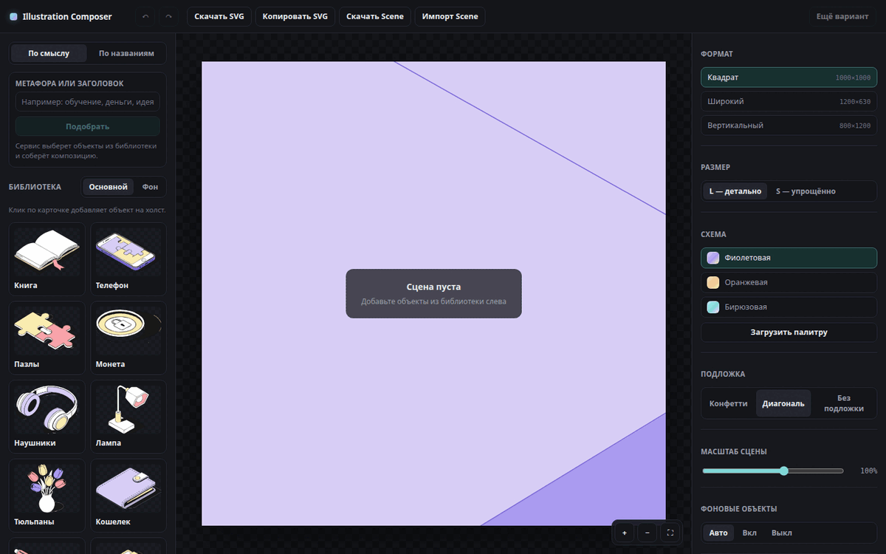

# Illustration Composer

Веб-сервис собирает изометрические иллюстрации из **готовой векторной библиотеки**
(10 предметов × 2 состояния) и экспортирует их как редактируемый SVG. Сервис ничего
не рисует и не генерирует: любой итог состоит только из исходных объектов, их можно
двигать, дублировать, менять порядок, состояние, размер, формат и цвета.



## Что умеет

- **Сценарий 1 — по смыслу.** Метафора или заголовок → Claude API (или локальный
  fallback) выбирает объекты строго из каталога → `layout()` собирает композицию.
  Пользователь видит `fit` и честную пометку, если библиотека выражает метафору лишь
  приблизительно.
- **Сценарий 2 — по названиям.** Поиск с падежами, ё/е, опечатками; несколько названий
  через запятую, чипсы, подсказки. Неизвестное слово не создаёт новый объект.
- **Редактор.** Добавление, drag, поворот с предупреждением, дубликат, удаление,
  слои, undo/redo на 100 шагов, смена main/bg, масштаб сцены, вьюпорт.
- **Форматы и палитры.** Квадрат 1000×1000, широкий 1200×630, вертикальный 800×1200;
  размер S/L; три встроенные схемы и загрузка своей палитры (JSON, hex-список,
  CSS-переменные) с предпросмотром и ручной правкой слотов.
- **Экспорт.** SVG без растра, стилей и классов; `d` каждого пути байт-в-байт из
  библиотеки; один `matrix(...)` на объект; слои с читаемыми `ic1-*` id.

## Быстрый старт

```bash
pnpm install
pnpm ingest     # каталог, фрагменты, подложки, шаблоны (исходники уже в data/source)
pnpm dev        # http://localhost:5173
```

Требуется Node ≥ 20 и pnpm. Для E2E один раз установите браузер:

```bash
pnpm exec playwright install chromium
```

## Архитектура

```
Figma SVG ──ingest(1 раз)──► catalog + fragments + substrates + templates + relations
                                      │
текст ─► intent (LLM | fallback | search) ─► items[] ─► layout ─► Scene (JSON)
                                                              │
                                          editor (Zustand) ◄──┤
                                                              ▼
                                   buildSceneRender ──► React canvas
                                          └──────────► SVG export
                                     recolor(Palette) ──┘
```

Подробности — в [`docs/ARCHITECTURE.md`](docs/ARCHITECTURE.md). Ключевые принципы:

- **Scene — это JSON.** Всё остальное — чистые функции над ним.
- **Геометрия неизменна.** Координаты путей не пересчитываются; любые преобразования —
  только `transform` на обёртке `<g>`.
- **Один слой рендера.** Холст и кнопка «Скачать SVG» используют один
  `buildSceneRender`, поэтому редактирование и экспорт не расходятся.

### Хранение, извлечение и переиспользование SVG

1. **Ingest.** `scripts/ingest` читает экспорты Figma, исправляет кодировку `id`,
   достаёт группы по явной карте `data/curated/figma-map.json`, проверяет число путей
   и раскладывает заливки в 8 слотов (`bg-*`, `obj-*`, `ink`, `white`).
2. **Фрагменты.** Уникальный рисунок хранится один раз:
   `data/generated/fragments/<objectId>.<state>.<size>.json` — массив `{ d, fill,
stroke, attrs }`. Alias (фон S = фон L, лампа/тюльпаны S = L) ссылается на тот же
   файл: 28 файлов на 20 объектов × состояния × размеры.
3. **Нативные координаты.** S-вариант получает `toNative` (масштаб + перенос),
   вычисленный МНК по совпавшим путям, поэтому при смене S↔L объект не «прыгает».
4. **Сцена — ссылки.** `Instance` хранит `objectId`, `state`, позицию и поворот.
   Дубликаты не копируют геометрию: рендер идёт из тех же фрагментов.
5. **Ленивая загрузка.** В приложении JSON-фрагменты Vite разбивает на отдельные
   чанки; каталог загружается один раз.

### Перекраска

В фрагментах только слоты. При рендере/экспорте слот заменяется hex из выбранной
палитры (`fill` и `stroke`), `white` нормализуется в `#FFFFFF`. Палитра из списка
6 цветов назначается автоматически: три ближайших тона в OKLCH упорядочиваются по
светлоте в `bg-*`, остальные — в `obj-1..3` в порядке ввода. Полная схема из 8 цветов
используется как есть.

### Раскладка

- **Авторские шаблоны** из 18 кадров примеров: если набор запроса совпадает или
  является подмножеством набора шаблона, берётся расстановка дизайнера.
- **Генератор**: детерминированный `mulberry32`, герой по `heroWeight`, стопки из
  `relations.json`, изометрические оси ±30°, 300 кандидатов и скоринг (SAT-перекрытия,
  обрезка, зона заголовка, баланс, плотность). Автоскейл 0.35–1.4.
- «Ещё вариант» — следующий seed.

### Вход по смыслу и LLM

`api/compose-intent.ts` вызывает Claude API (`ANTHROPIC_MODEL`, по умолчанию
`claude-haiku-5-5`), передаёт каталог в системном промпте, валидирует ответ `zod`-схемой
и правилами каталога. Ключ только на сервере, лимит 20 запросов/час на IP, кэш по хэшу,
при ошибке/лимите/отсутствии ключа — локальный fallback. Подробнее —
[`docs/AI_TOOLS.md`](docs/AI_TOOLS.md).

## Команды

| Команда                | Назначение                                                |
| ---------------------- | --------------------------------------------------------- |
| `pnpm dev`             | Vite dev-сервер                                           |
| `pnpm build`           | Проверка типов и production-сборка                        |
| `pnpm ingest`          | Пересобрать каталог/фрагменты/подложки/шаблоны            |
| `pnpm facts`           | 18 проверок фактов о библиотеке и свежести generated      |
| `pnpm lint:export`     | Линт всех 18 экспортов примеров                           |
| `pnpm test`            | Unit + golden-тесты (Vitest)                              |
| `pnpm e2e`             | Playwright: 11 сценариев редактора и входов               |
| `pnpm verify`          | `typecheck + lint + facts + lint:export + test`           |
| `pnpm examples`        | Пересобрать 3 примера в `examples/`                       |
| `pnpm preview:layouts` | Контактные листы 10 наборов × 3 формата                   |
| `pnpm demo`            | Скриншоты и `docs/demo.gif` (нужен запущенный `pnpm dev`) |

## Тестирование

- **Факты библиотеки** (`pnpm facts`): число путей, свотчи палитр, масштабы S→L,
  alias, 18 кадров, teal-оракул подложки, свежесть generated.
- **Золотой оракул перекраски**: объекты из `reference-drop` (orange L, teal S)
  сопоставляются с каталогом, цвета сверяются на 100 % для найденных путей.
- **Байтовая сохранность**: все `d` в экспорте совпадают с каталогом.
- **Воспроизведение примеров**: 18 кадров рендерятся через `resvg` и сравниваются
  с исходником; пиксельный порог 32 по каналу, лимит 3 % (scene-2 — 30 % из-за
  намеренной перекраски кошелька в примере).
- **Раскладка**: 18/18 авторских сцен, средняя ошибка 0.0000 px; детерминизм,
  отсутствие запрещённых перекрытий, зона заголовка.
- **E2E**: добавление, drag, дубликат, undo, размеры/палитры/форматы, слои,
  автосохранение, скачивание SVG, оба сценария ввода, загрузка палитры, 60 fps
  при 8 объектах (замер 16,67 мс).

## Примеры

| Файл                                                                 | Сцена                    | Формат    | Схема  |
| -------------------------------------------------------------------- | ------------------------ | --------- | ------ |
| [`examples/01-learning-square.svg`](examples/01-learning-square.svg) | книга + телефон          | 1000×1000 | purple |
| [`examples/02-finance-wide.svg`](examples/02-finance-wide.svg)       | лампа + кошелёк + монета | 1200×630  | orange |
| [`examples/03-focus-tall.svg`](examples/03-focus-tall.svg)           | тюльпаны + наушники      | 800×1200  | teal   |

Превью — одноимённые `.png`. Все три собраны тем же экспортёром, что и кнопка
«Скачать SVG», и проходят `lint:export`.

Визуальная проверка раскладки: [`docs/layout-preview-square.png`](docs/layout-preview-square.png),
[`docs/layout-preview-wide.png`](docs/layout-preview-wide.png),
[`docs/layout-preview-tall.png`](docs/layout-preview-tall.png).

## Деплой

Проект готов для Vercel: статический Vite-фронтенд + serverless-функция
`api/compose-intent.ts`.

```bash
cp .env.example .env
# ANTHROPIC_API_KEY=...
vercel --prod
```

Переменные: `ANTHROPIC_API_KEY`, `ANTHROPIC_MODEL` (по умолчанию `claude-haiku-5-5`),
`COMPOSE_RATE_LIMIT_PER_HOUR` (20). Ключ никогда не попадает в клиентский бандл.
Публичная ссылка на деплой появляется после выполнения команды; в репозитории её нет.

## Исходные данные

`data/source/` — read-only: листы L/S, страница примеров, six SVG-drop и PDF-брифы.
Полный список с исходными именами — в [`docs/PROGRESS.md`](docs/PROGRESS.md).
`pnpm ingest` детерминирован и идемпотентен; `pnpm facts` проверяет свежесть
`data/generated`.

## Ограничения и принятые решения

- **Пропорции** объектов между собой неизменны; отдельного ресайза объекта нет.
  Эталон — «Примеры композиций» (ASK-01), а не SVG-drop.
- **Поворот** доступен с предупреждением «нарушает изометрию» (ASK-02), по умолчанию 0°.
- **Поворот/отражение** не входят в автоматическую раскладку (ASK-07).
- **ASK-03**: в примерах нет чистой перестановки `obj-1..3`; дизайнер перекрасил
  кошелёк в сцене 2 шире (`bg-light→obj-1`, `obj-1→obj-2`). Механизм per-object
  перекраски не реализован, примеры используются как эталон раскладки.
- **S/L** меняет детализацию, а не масштаб сцены (ASK-04).
- **Ограничения LLM**: без ключа/при лимите работает локальный подбор; `fit`
  показывает, насколько библиотека выражает метафору.
- **Подложки** извлечены по форматам из примеров; библиотечная версия годится только
  для квадрата.

История решений — [`docs/DECISIONS.md`](docs/DECISIONS.md), журнал фаз —
[`docs/PROGRESS.md`](docs/PROGRESS.md).

## Структура

```
api/                 serverless-функция compose-intent
data/source/         исходники (read-only)
data/curated/        явная карта Figma, палитры, семантика объектов
data/generated/      catalog, fragments, substrates, templates, relations, stats
scripts/             ingest, facts, lint-export, examples, previews, demo
src/core/            чистая логика: слоты, палитры, сцена, геометрия, render, export,
                     раскладка, intent — без DOM/React
src/app/             React UI: store, canvas, panels, dialogs, i18n
tests/               unit, golden, e2e
examples/            3 готовые композиции (SVG + PNG)
docs/                архитектура, решения, прогресс, AI-инструменты, превью
```

Границы модулей проверяются ESLint: `src/core` не импортирует `src/app` и не использует
`window`/`document`/`localStorage`/`fetch`.
